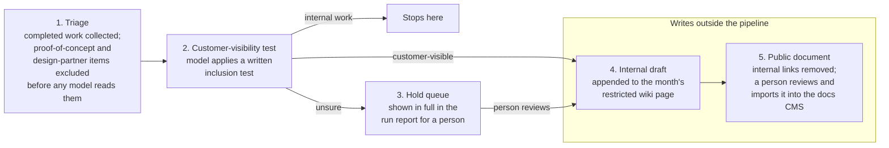

# Guardrails for AI-assisted publishing

**Type:** Case study: disclosure and confidentiality controls, human-in-the-loop design, applied safety for deployed AI agents
**When:** November 2026
**Author:** Kathryn Collins
**Prepared for:** [Technical Editor, Editorial Publishing, Anthropic](https://job-boards.greenhouse.io/anthropic/jobs/5443997008)

## What this shows

Deciding what may become public when AI drafts customer-facing text, and keeping the final disclosure decision with a person. It shows disclosure judgment, agent permissions enforced twice (in the agents' instructions and by scoped tokens and access), a postmortem of a silent failure, and limits stated plainly.

## Summary

At BigPanda, AI now drafts much of what customers read about product changes, so the real design problem is deciding what may become public. I designed the human-in-the-loop and AI-handoff process behind our monthly customer Bug Fix Log: AI triages shipped engineering work and drafts entries, and people verify, approve and publish. No automated step writes to the public docs site. This case study covers the pipeline, its controls, one silent failure we found and fixed, and the limits I chose to keep manual.

Portfolio note: internal names, identifiers and figures are sanitized.

## The problem

Customers need to know what was fixed, but most engineering tickets are not fit to publish as written. Engineering ships fixes across many teams every week. A typical ticket mixes three things: the customer-visible change, internal detail (code paths, tracker links, team names), and context that must never leave the company, such as customer names, proof-of-concept work or unreleased features.

Before this process, there was no public log: customers could learn about a fix only by opening a support ticket. Publishing a log first had to answer security's concerns. The controls below were designed to answer those concerns. Fully automating it would scale, but it would put an AI system in the position of deciding what the company discloses. The goal was the middle ground: let AI do the reading and drafting, and keep every disclosure decision with a person.

## Design

The pipeline runs weekly and moves each fix through five stages. Only the last two write anywhere outside the pipeline: stage 4 to a restricted internal page, and stage 5 to a document that a person imports into the public docs.

Stages 1 to 3 produce nothing a customer can see. Stage 4 writes only to a restricted internal page. Only stage 5 produces anything a customer will see, and a person does the import.

1. **Triage.** A scheduled pass collects engineering work marked complete that week. Items marked as proof-of-concept or design-partner work are excluded before any model reads them.
2. **Customer-visibility test.** A model (Sonnet) applies a written inclusion test: would a customer notice this change? Internal refactors, tooling and infrastructure work fail the test and stop here.
3. **Hold queue.** Anything the model cannot decide is not guessed. It goes into a held block marked for verification, and that block is shown in full in the run report, because it exists nowhere else.
4. **Internal draft.** Passing entries are written in house style and appended to the month's internal page. Earlier weeks are never reordered or rewritten, and a month's page is matched by exact title, never by position.
5. **Public document and human import.** The run produces a separate customer document. Internal tracker links are removed, because customers cannot reach them. A person reviews it and imports it into the docs CMS; nothing publishes it automatically.

Every run ends with a summary and an explicit action list, including the held items, so nothing waiting on a person is lost in a long report.

## Controls

Each control answers one question: what stops sensitive content from reaching the public docs if another layer fails?

| Control | What it prevents | Where it sits |
| --- | --- | --- |
| Exclusions for proof-of-concept and design-partner work | Unreleased or customer-specific work entering the pipeline at all | Before any model call |
| Written inclusion test | The model improvising its own disclosure standard | Triage |
| Hold queue instead of best guess | Uncertain items being published by default | Triage output |
| Internal and public versions kept separate | Internal links, identifiers and customer names leaking into customer copy | Drafting |
| Restricted draft pages | Early drafts being read as published fact | Internal wiki |
| Human import into the docs CMS | Any automated write to the public site | Publishing |
| Per-surface allow-list for agents | Agents writing outside their lane | All agents |

The last row is where I take part directly in the safety design of our AI workers. The digest agent (the agent that triages engineering work for documentation impact) works from an allow-list for each surface it touches:

- Each system the agent touches has its own short list of permitted actions, limited to what its job needs. For example, in the issue tracker it can create tickets only for the docs team.
- It has no access at all to the public docs CMS.

Actions that change ownership or publish are reserved for people. If the tracker is unreachable, the run stops instead of reporting an empty week. The rules are written into the agent's instructions and enforced by scoped tokens and access, so an agent cannot write outside its lane even if it misreads its instructions.

The same rules are enforced across a suite of Claude skills owned by different workflows (style, release guides, change-impact audit, in-app validation), using shared terminology and a shared Feature Name Registry, so a feature is named the same way in every public surface. Customer names, which internal tickets use freely, are stripped from every public entry.

## Failure and fix

For several weeks, the drafting gate in our change-impact pipeline fired on zero projects, and nothing reported an error. The gate waited for a release-readiness label before drafting customer content. The configuration assumed a workspace-wide project label; in reality the label existed only as an issue label on one team. Every run found nothing to draft and reported, accurately, that there was nothing to draft.

- **Detection.** Our scheduled weekly review of new automations compares what each one actually did on real data with how it behaved in testing. That review showed no project had reached drafting since the redesign, which was implausible given what had shipped. Tracing the signal back to its source showed the label had never existed at the scope the config expected.
- **Fix.** We created a workspace-level label under the release-stage group, kept the old team label as an alias, and changed the gate to read the signal from each issue in a project rather than from the project itself.
- **Prevention.** Run reports now include a one-line heartbeat with counts, so a run that finds nothing is visible as a number rather than as silence.

The lesson carried into the rest of the system: a safeguard that fails closed can look exactly like a quiet week. I now design gates to report a count, not only a result.

## Trade-offs and limitations

The process is deliberately slower than it could be, and it does not catch everything.

- **Publishing stays manual.** An automated import would save time each month. I kept it manual because the import is the last point where a person sees the full public document before customers do.
- **Held items cost reviewer time.** Routing uncertain items to a person means some weeks carry a real review load. The alternative, a model choosing for us, moves the disclosure decision to the wrong place.
- **Exclusions are a first filter.** The inclusion test and human review catch what the first filter misses.
- **The inclusion test reads tickets, not code.** If a ticket understates a change, the entry will too. Accuracy still depends on review with engineering.
- **Silent success and silent failure look alike.** The failure above shows this. Counts in every run report reduce the risk but do not remove it.

## What this taught me about disclosure

The hard part of AI-assisted publishing is not drafting; it is deciding what a system is allowed to say, and proving that decision held. Four habits from this work carry directly to writing about AI systems themselves.

- **Treat the security concern as a design requirement.** The log shipped only after the process answered each concern point by point.
- **Write the standard down before the model applies it.** A written inclusion test can be reviewed, argued with and changed. A model's implicit judgment cannot.
- **Make uncertainty visible instead of resolving it quietly.** Held items, and the counts that exposed our silent failure, are the publishing equivalent of stating a limitation plainly.
- **Keep the final disclosure decision with a person who can see the whole document.** Automation can narrow what a reviewer reads; it should not remove the reviewer.

This work is small in scale compared with reporting on frontier models. The judgment it exercises is the same: what is true, what is safe to say, and what the reader needs to know about what we could not check.
